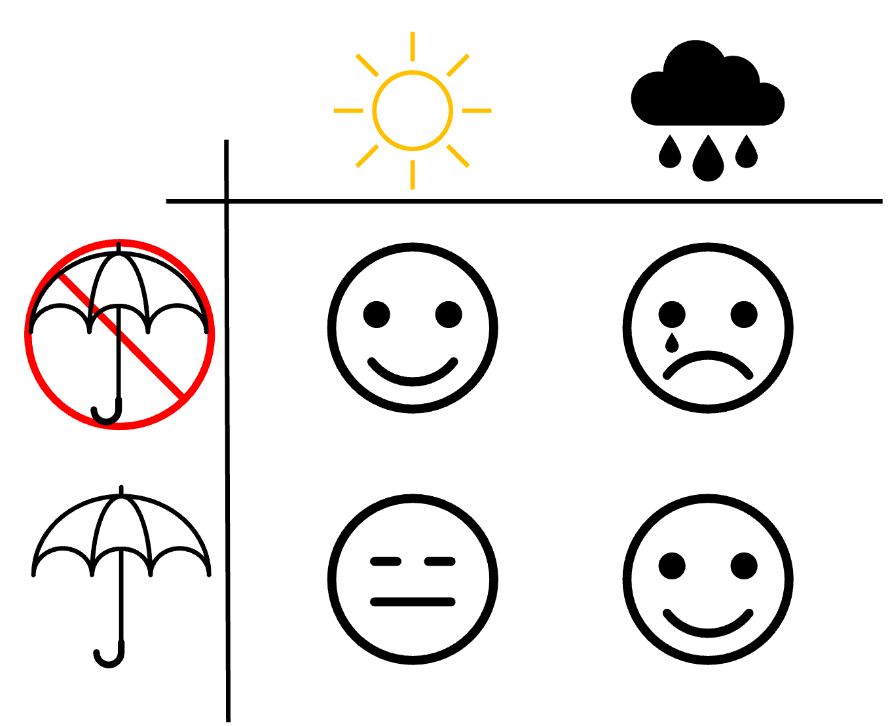

Every day we make decisions based on uncertain information.
Living in the UK, a classic example of this is deciding whether to take an umbrella with you.
Weather forecasts are notoriously uncertain.
They can predict a clear blue sky and it ends up bucketing it down.
That's why most of the time I have an umbrella in my bag, just in case.
It's a regret-minimising decision: the cost of bringing my umbrella with me and not needing it is much lower than needing it and not having it.
Here is a simple diagram outlining the possible states:

If we were to naively automate this system using a typical _predict-then-optimise_ approach there would be two steps:

1. Create a rain prediction model that outputs a yes or no for whether it will rain.
2. Create an optimisation process (in this case just a check to see if rain is predicted) to decide whether I need an umbrella.

I'm sure you can see a number of issues and some obvious ways to improve this approach.
We could do more than just predict a binary variable, $$p \in \{0, 1\}$$, for whether it will rain; we could predict a probability or how heavy the rain will be.
Doing so would complicate our optimisation step, perhaps now using a threshold value.
However, this doesn't address the underlying issue: what if the prediction is wrong?
The optimisation process has no knowledge that it's using predictions, and more importantly, the model has learned to minimise its prediction error ($$L2$$) with no regard for the optimisation.
Unlike the predict-then-optimise approach,
Decision-Focused Learning is the process of teaching machine learning models to generate predictions that, when used to make a decision, minimise regret.

<!--more-->

# The maths

## Machine learning

The typical machine learning (ML) process is defined as follows.
Given a set of pairs of features and labels:
$$\mathcal{D} = \{(x_1,y_1), (x_2,y_2) \ldots (x_n, y_n)\}$$ where $$x_i$$
is an $n$-dimensional feature vector $$x = [f_1, f_2 \dots f_n]$$ sampled from $$X$$
and its values have some correlation to $$y_i$$.

Assuming that it exists, we want to learn the true function
$$\mathcal{F}(x_i) = y_i$$. However, this isn't possible, so we use the
data, $D$, to learn a model $$M$$ where $$M(x_i) \rightarrow \hat{y}_i$$
that minimises a loss function $l$ between $y$ and $\hat{y}$.
A typical loss function might look something like
$l = (\hat{y}_i - y_i)^2$. For a parametrised model the learning
process looks like

$$\theta^* = \operatorname*{argmin}_\theta \frac{1}{n} \sum_{i=0}^n l(y_i, M_\theta(x_i)) \label{eq:ch0:ml-learning}$$

where $$\theta^*$$ are the optimal parameters for the
model given the data available.

## Optimisation

In a classical optimisation process, we attempt to find the optimal
solution $$z^*$$ to a problem. $$z^*$$ is typically defined as being drawn
from the set of all valid solutions $$z^* \in Z$$, though in some notation
$$Z$$ can be the space of all possible solutions, valid or not, and
constraints are applied to the optimisation process. We will use $$Z$$ for
the valid solution space and $$\mathcal{Z}$$ for the larger space of all
possible solutions. In mathematical notation,
$$Z \subseteq \mathcal{Z} \quad \text{s.t.} \; g_i(z)\leq 0, \textrm{for} \: i \in \{1, \ldots, m\} \;\forall z \in Z$$
where $$g$$ is a constraint on the solution.

The optimality of a solution is measured using a fitness function $$f$$.
We can define the optimisation process as

$$
  z^*= \operatorname*{argmin}_{z \in Z} f(z)
  \label{eq:ch0:opt}
$$

Of note here is that $$f$$ can often be computationally expensive or $$Z$$
so large that it is infeasible to try all possible solutions. As such,
methods must be used to reduce the search space to find the solution.
This is typically a combination of heuristics (often defined using
domain expertise) and advanced search methods such as genetic
algorithms. In fact, the machine learning problem defined in
Equation \eqref{eq:ch0:ml-learning} is itself an optimisation problem.

In the case of the ML problem with a parametrised model such as a
neural network, it is possible to calculate gradients and use them to
direct the exploration of the solution space in order to find a solution
$$\hat{z}^*$$ that is close to the true optimal solution, i.e.
$$\hat{z}^* \approx z^*$$.

## Predict-then-Optimise

In the predict-then-optimise setting, the optimisation process depends
on some unknown values. To find the true optimal solution, the fitness
function must be conditioned on the unknown values $$y$$. As such,
Equation \eqref{eq:ch0:opt} must be reformulated to
$$z^*(y) = \operatorname*{argmin}_{z \in Z} f(z, y)$$. In a practical
sense, this is infeasible as $$y$$ is unknown. To circumvent this issue
the model $$M_\theta$$ can be used as $$x$$ is available. Using $$M_\theta$$
we can generate a value $$\hat{y}$$ to be used in the optimisation.

$$\begin{aligned}
\label{eq:ch0:pred-then-opt}
    \hat{z}^*(M_\theta(x)) = \hat{z}^*(\hat{y}) = \operatorname*{argmin}_{z \in Z} f(z, \hat{y})
\end{aligned}$$

We use the notation $$\hat{z}^*$$ here to denote that it is the optimal
solution found using predictions of $$y$$. If the model perfectly
reconstructs the true values of $$y$$ then the solution found should be
the true optimal solution, i.e. $$\hat{z}^* = z^*$$.

Note that $$\dim(y) = D$$ is typically high as all values needed to
parametrise the optimisation problem are predicted. As such it is
likely comprised of the output of multiple models:
$$\hat{y} = [\hat{y}_1, \ldots, \hat{y}_D] = [M_\theta(x_1), \ldots, M_\theta(x_D)]$$
where each model predicts an individual component, e.g. travel time,
supply, demand, and cost.

* **Pros**

  Simple to implement. Predictive models are fairly easy to learn, and any optimisation method can be used downstream.

* **Cons**

  No information about the optimisation process is passed into the predictive model. It has been shown that model misspecification can lead to extreme errors when multiple correlated variables are combined in the optimisation process (Cameron et al., 2022).

## Decision-Focused Learning

In the PtO setting, we noted that $$\hat{y} = y$$ should result in a
solution where $$\hat{z}^* = z^*$$. However, models learned using
Equation \eqref{eq:ch0:ml-learning} will almost always have some error. The
error induced by the suboptimal solution $$\hat{z}^*$$ selected because
$$\hat{y} \neq y$$ is called the decision loss (DL). It is the value of the fitness function
of the solution $$\hat{z}^*$$ generated using predicted values, evaluated
using the ground truth values of $$y$$.

$$
    DL(\hat{y}, y) = f(\hat{z}^*(\hat{y}), y)
    \label{eq:ch0:dl}
$$

In a DFL setting
our goal is reformulated. We aim to learn a model $$M_\theta$$ that
minimises the DL.
For the dataset $$\mathcal{D}$$, the learning process becomes:

$$
    \theta^* = \operatorname*{argmin}_{\theta}\ \frac{1}{n} \sum_{i=1}^{n}\ DL(M_\theta(x_i), y_i)
$$

* **Pros**

  Better downstream decision performance.

* **Cons**

  Harder to implement, can be more computationally expensive to train, and often still requires repeated calls to an expensive solver.

---

## Update (2025)

Following this post, we investigated surrogate-based DFL and proposed an evolutionary directed-perturbation strategy to reduce the number of solver evaluations needed to fit surrogate loss models, published at IJCNN 2025: [*Directed perturbations for efficient learning of surrogate losses*](https://ieeexplore.ieee.org/document/11227956) (DOI: `10.1109/IJCNN64981.2025.11227956`, [code](https://github.com/TimCargan/directed-perturbations)).

Subsequent doctoral work examined the limitations of surrogate methods across domains and moved to an integrated Predict-and-Optimise formulation using RL-trained neural combinatorial solvers in JAX and Flax as differentiable task-gradient operators. A summary of the full thesis is on the [PhD Research](/projects/phd/) page.
